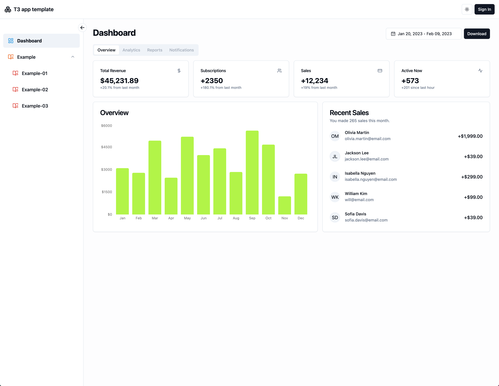
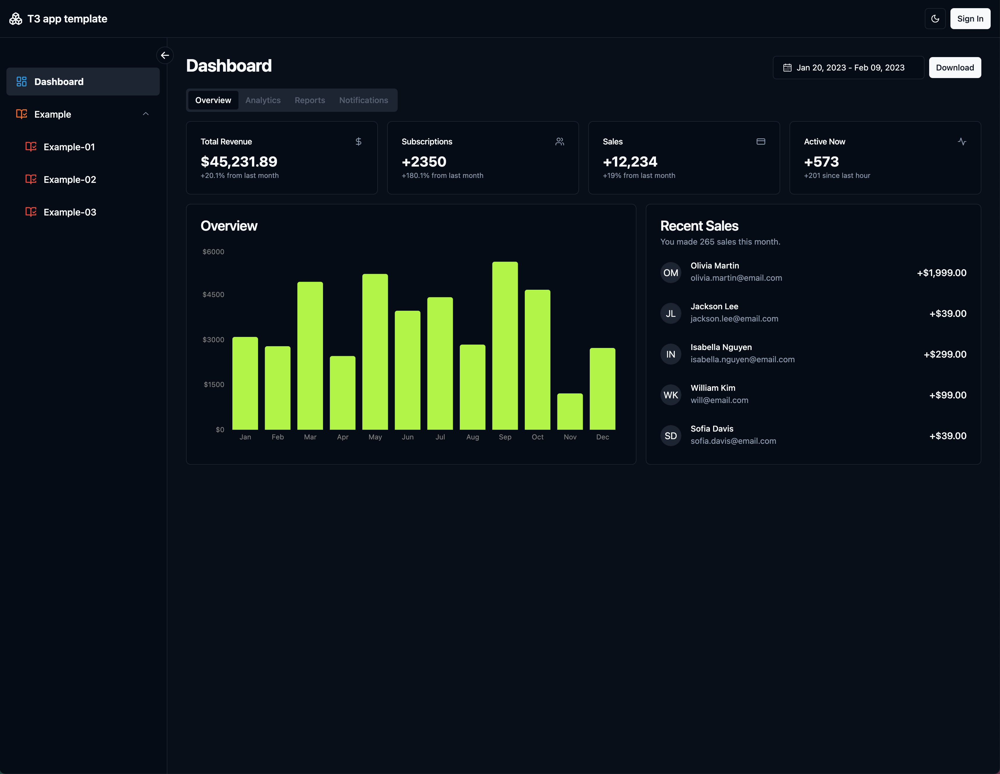
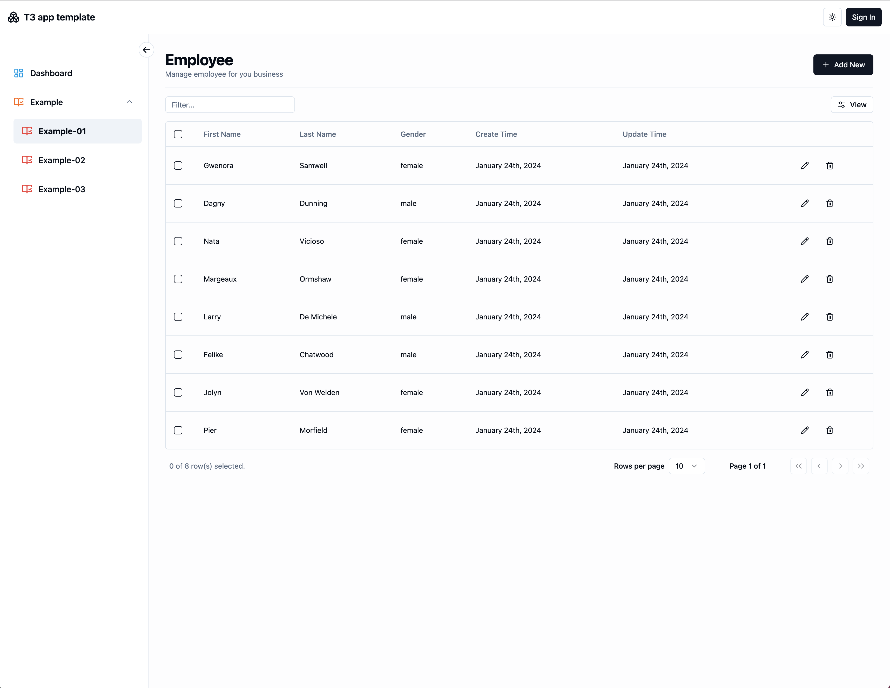
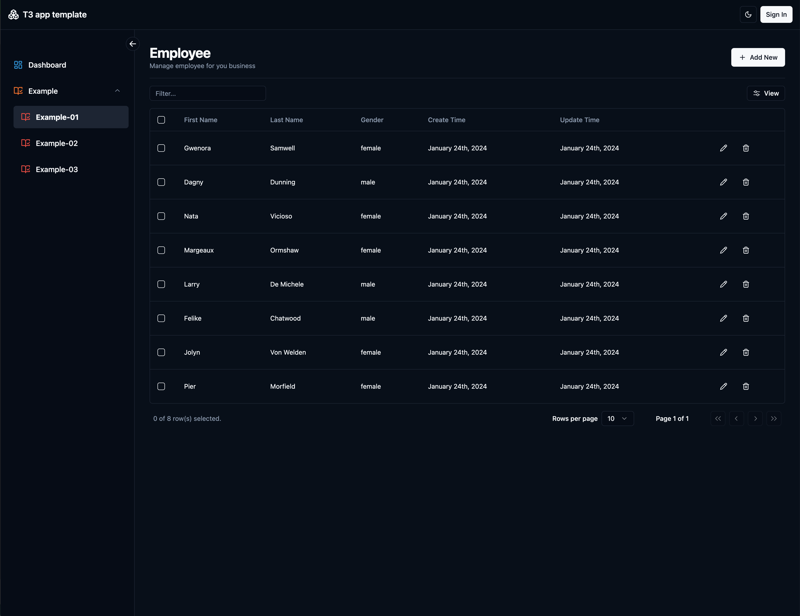

T3 Stack with shadcn-ui Admin Layout

## Features

- Theme Switching: Allows users to switch the interface theme according to their preference or requirement.
- Responsive Sidebar: A flexible sidebar that adapts to different screen sizes and devices.
- Sidebar Shrinking: Users can expand or collapse the sidebar as needed to optimize screen space.
- Secondary Menu in Sidebar: For better organization and access, the sidebar includes multi-level menus.
- Mobile Sidebar: Specially designed for mobile devices to ensure smooth usage on smaller screens.
- Tanstack Table: Use tanstack table to implement curd operation
- NextAuth: Implemented Github login using NextAuth
- Global: Header, Loading and Modal
- Select: Implement multi-select input example
- Step Form: Implement step-form example

## Dashboard Demo

